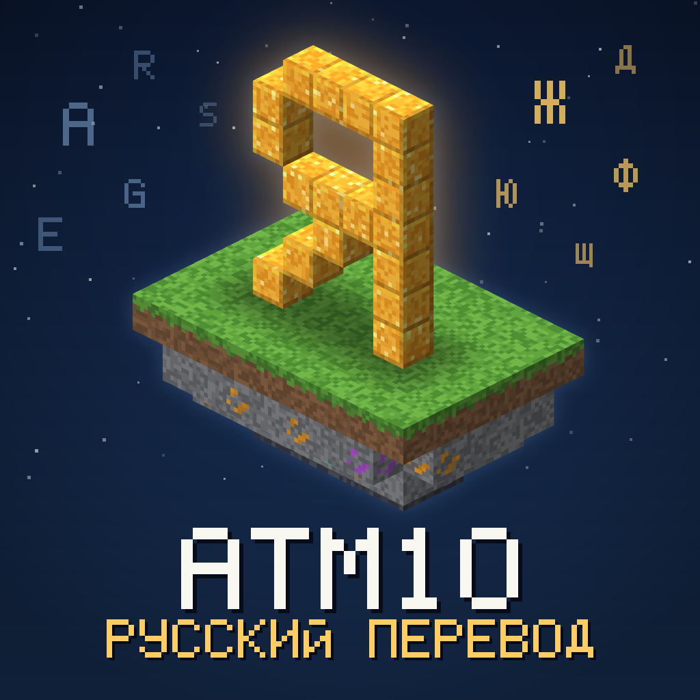

# Bukvar: ATM10 Russian Translation

An unofficial Russian translation add-on for **All the Mods 10 (ATM10)**. It fills in missing Russian translations for mods and their in-game content. If a mod already has a good Russian translation, this pack leaves it unchanged.

## What's Included

- **75,749 translated strings across 355 mods:** item and block names, tooltips, user interfaces, settings, achievements, and book texts.
- **337 in-game guide files:** complete translations for Allthemodium, LaserIO, Industrial Foregoing, and Just Dire Things, plus the start of the AE2 guide (34 of 125 files). Other guides are still in progress.
- **Quest translation (8,436 strings):** the game does not read quest text from resource packs, so `quests_ru/ru_ru.snbt` has to be copied manually — instructions are in `quests_ru/README.txt`.
- **New Neo Vitae translation:** 3,493 strings translated using a consistent terminology glossary, including the mod's book.
- **Missing translations in existing Russian language files:** Occultism, Mahou Tsukai, JourneyMap, Productive Bees, Ars Elemental, Sodium Extra, and others.

### Mods That Needed the Most Translation Work

AllTheCompressed, Auroral, Bibliocraft Legacy, Cable Tiers, Camol, Chipped, Chisel Reborn, Dyenamics, Everything is Copper, Luminax, MEGA Cells, Modern Dynamics, More Red, MrCrayfish's Furniture, Pam's HarvestCraft, RFTools, Rechiseled, Starbunclemania, Step Crafter, Steve's Carts 2, Sushi Go Crafting, Tempad.

## Installation

1. Place the downloaded file into your modpack's `resourcepacks` folder. Do not extract it.
2. Launch the game and open **Options → Resource Packs**.
3. Move **ATM10_RU_Fill** to the right-hand column. If you use another Russian resource pack, place this one above it.
4. Make sure Russian is selected in the language settings.

## Compatibility

This pack is made for **ATM10 8.5** (Minecraft 1.21.1, NeoForge). Some strings may remain in English when using other modpack versions.

## Translation Process

The translation was created with the help of AI (Kimi), while decorative block names were generated using terminology glossaries. Terms were cross-checked against Minecraft's official Russian localization, translated ATM10 quests, and Russian language files provided by the mods themselves. Formatting codes were checked automatically.

The text has been selectively reviewed rather than checked line by line. The pack has not yet been fully tested in-game, so inaccuracies may occur. If you find an error, please leave a comment with the mod name, item or text, and the suggested correction.

## Copyright and Disclaimer

This is an unofficial project and is not affiliated with the All the Mods team or the authors of the included mods. All rights to the mods, their names, and original texts belong to their respective authors. This pack contains translations only, with no mod code or textures.

If you are a mod author and do not want your mod's translation included in this pack, please contact me and I will remove it.

---

# Букварь: русификатор ATM10

Дополняет русскую локализацию сборки **All the Mods 10**: переводит то, что в модах осталось на английском. Там, где у мода уже есть хороший русский перевод, пакет его не трогает.

## Что внутри

- **75 749 строк в 355 модах:** названия предметов и блоков, подсказки, интерфейс, настройки, достижения и тексты книг.
- **337 файлов гайдов:** полностью Allthemodium, LaserIO, Industrial Foregoing и Just Dire Things, начало гайда AE2 (34 файла из 125). Остальные гайды в работе.
- **Перевод квестов (8 436 строк):** игра не читает текст квестов из наборов ресурсов, поэтому файл `quests_ru/ru_ru.snbt` копируется вручную — инструкция в `quests_ru/README.txt`.
- **Новый перевод Neo Vitae:** 3493 строки по единому словарю терминов, включая книгу мода.
- **Строки, оставшиеся английскими в русских файлах модов:** Occultism, Mahou Tsukai, JourneyMap, Productive Bees, Ars Elemental, Sodium Extra и другие.

### Моды, которым больше всего не хватало перевода

AllTheCompressed, Auroral, Bibliocraft Legacy, Cable Tiers, Camol, Chipped, Chisel Reborn, Dyenamics, Everything is Copper, Luminax, MEGA Cells, Modern Dynamics, More Red, MrCrayfish's Furniture, Pam's HarvestCraft, RFTools, Rechiseled, Starbunclemania, Step Crafter, Steve's Carts 2, Sushi Go Crafting, Tempad.

## Установка

1. Положите скачанный файл в папку `resourcepacks` вашей сборки. Распаковывать его не нужно.
2. Запустите игру и откройте **Настройки → Наборы ресурсов**.
3. Перенесите **ATM10_RU_Fill** в правый столбец. Если вы используете другой русский пакет, поставьте этот выше него.
4. Проверьте, что в настройках языка выбран русский.

## Версии

Пакет сделан для **ATM10 8.5** (Minecraft 1.21.1, NeoForge). В других версиях сборки часть строк может остаться на английском.

## Как сделан перевод

Перевод выполнен с помощью ИИ (Kimi), а названия декоративных блоков собраны генератором по словарям. Термины сверялись с ванильным русским переводом Minecraft, переведёнными квестами ATM10 и русскими файлами самих модов. Коды форматирования проверены автоматически.

Текст вычитан выборочно, а не построчно, и в игре пакет пока не проверялся, поэтому неточности возможны. Если заметили ошибку, напишите в комментариях: мод, название предмета или строки и как правильно.

## Авторские права

Это неофициальный проект, он не связан с командой All the Mods и авторами модов. Права на моды, их названия и исходные тексты принадлежат их авторам. Пакет содержит только переводы, без кода и текстур.

Если вы автор мода и не хотите, чтобы перевод вашего мода был здесь, напишите мне, и я его уберу.
